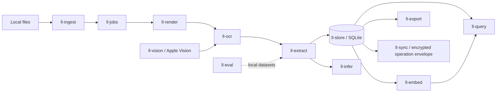

# Architecture

Ledgerlens is a local-first paperwork pipeline. Source documents, extracted records, model weights,
and query results remain on the user's device unless an explicitly enabled integration is added.
The Rust workspace is divided by domain boundary. `ll-app` composes the crates into the service the
Tauri desktop app (`apps/desktop`) calls; the relay application is not wired yet.

## Data flow

## Crate responsibilities

| Crate        | Current boundary                                                                                | Remaining planned work                                                                |
| ------------ | ----------------------------------------------------------------------------------------------- | ------------------------------------------------------------------------------------- |
| `ll-core`    | Shared IDs, dates, money, errors, configuration, and domain types                               | Expand shared record/evidence contracts as storage grows                              |
| `ll-store`   | SQLite migrations, documents, extraction fields, line items, invoice projections, and correction history | Pages, evidence, bank transactions, and vector-extension migrations |
| `ll-infer`   | Model registry, artifact size/checksum validation, provider selection, batching, tensor helpers | Bind the registry to a production ONNX Runtime backend                                |
| `ll-render`  | Image processing and PNM test rendering                                                         | PDF rendering, deskew, and production rasterization                                   |
| `ll-ocr`     | OCR engine boundary, CTC decoding, and reading-order grouping                                   | Production detection/recognition model adapters                                       |
| `ll-extract` | Rules extraction, validation, confidence calibration, persistence                               | Learned token classification and VLM escalation                                       |
| `ll-ingest`  | Recursive supported-file scan, SHA-256 fingerprinting, deterministic deduplication, policy-bounded folder scans (depth, file count, size, no symlinks) and `O_NOFOLLOW` reads | OS file-notification events (watching polls instead)                          |
| `ll-jobs`    | SQLite-backed queue, leases, retry/backoff, permanent failure, cancellation, re-armed dedupe keys, crash recovery | Multi-process workers                                                    |
| `ll-embed`   | SQLite vector persistence and exact cosine ranking                                              | `sqlite-vec`, page embeddings, and model-backed indexing                              |
| `ll-query`   | Validated spend query DSL, bound SQL plans, and reciprocal-rank fusion                          | Natural-language intent parsing and full retrieval answer/citations                   |
| `ll-export`  | Canonical, QuickBooks-shaped, and Xero-shaped CSV output                                        | Provider API integrations and reconciliation export workflows                         |
| `ll-sync`    | Versioned XChaCha20-Poly1305 operation envelopes and table allow-list                           | Durable op-log, key provisioning/rotation, replay protection, and relay transport     |
| `ll-app`     | Import (magic-byte sniffing, 25 MB cap, private blob store), PDF text-layer reading, OCR fallback for scans and photos (isolated, time-limited), review edits with correction history, approvals and bulk approval, likely-duplicate detection, FTS5 full-text search, settings, vendor summaries, question parsing, reports, CSV export with a confirm step, background reading through `ll-jobs` (crash recovery, cancellation), opt-in folder watching | Watching on Windows/Linux (no folder dialog there yet) |
| `ll-vision`  | macOS: Quartz page rendering (PDF pages, EXIF-upright photos, pixel caps) and Apple Vision text recognition behind `PageRenderer`/`OcrEngine` | OCR on Windows and Linux (another `OcrEngine`) |
| `ll-eval`    | SROIE/CORD sample pairing, CORD v2 parquet reader (dev-only `parquet` crate), end-to-end scoring through `ll-app` (field P/R/F1, line prices, review routing), latency/RAM/hardware capture, `results.json` recording | SROIE scoring (licence unclear), OCR-text error reports |

The top-level model inventory is [models/manifest.json](../models/manifest.json). It contains no
weights or unverified model claims. Benchmark outputs belong in
[benchmarks/results.json](../benchmarks/results.json); empty results are intentional until runs
have reproducible dataset, model, and hardware metadata.
          
## Invariants

- Amounts are signed integer minor units plus an ISO currency code; floating-point amounts are not
  used for financial totals.
- Persistent document and job identifiers are ULIDs.
- User-provided values are bound SQL parameters. Query grouping and table names come from enums and
  allow-lists, not generated SQL fragments from natural-language input.
- Every model artifact added to the inventory needs a verified SHA-256, byte size, and license.
- The sync crate encrypts an operation payload; it does not provide key distribution or a transport.
- Model weights, datasets, and real benchmark numbers are not checked into this repository.

## Validation

Run `cargo test --workspace` from the repository root. The current tests exercise crate-level
contracts and local SQLite behavior; they do not establish production PDF, model-runtime, sync, or
external accounting integration readiness.
